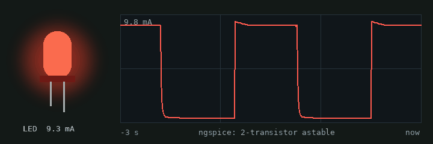
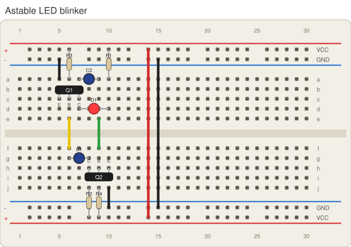

# skills

Claude skills plus the tooling to run them locally.

| Skill | What it does |
|---|---|
| [`breadboarding`](breadboarding/SKILL.md) | Designs, simulates (ngspice), lays out (bblayout) and documents verified half-breadboard circuits — LED blinkers, faders, strobes, 555 timers — with straight wiring and as-built checks. |

## Demo: the two-transistor blinker

The first circuit the skill produced, simulated in ngspice and laid out on a half breadboard with straight wiring only.





**What it does:** the LED blinks with a 1.33 s period (about 0.7 s on), at roughly 10 mA from a 5 V supply. The board passes bblayout's connectivity check (no shorts, no open nets), and a second simulation of the board as placed, including breadboard parasitics, gives the same period.

**How it works:** Q1 and Q2 form a cross-coupled astable multivibrator. When one transistor switches on, its collector drops by about 5 V, and the coupling capacitor drives the other transistor's base to about −4.2 V, switching it off. That base then recharges through its 47 kΩ resistor until it reaches V<sub>BE</sub> ≈ 0.65 V. Each half period is t ≈ ln2·R·C, so T ≈ 1.386 · 47 kΩ · 22 µF ≈ 1.4 s.

| Ref | Value | Role |
|---|---|---|
| Q1, Q2 | NPN (2N2222A, 2N3904, S8050…) | E-B-C pinout |
| R1 | 330 Ω | LED current limit |
| R2 | 1 kΩ | Q2 collector load |
| R3, R4 | 47 kΩ | base bias, sets the timing |
| C1, C2 | 22 µF electrolytic | timing (+ toward the collector side) |
| D1 | red LED | long leg = anode (A) |

### Build order

Holes are named row + column (rows a–e above the centre channel, f–j below; `T±`/`B±` are the top and bottom power rails). Transistor orientation: compare the column numbers of E and C. If E is in the lower-numbered column (E left of C), the flat face points toward the bottom edge of the board (toward you); if C is left of E, the flat face points toward the top edge. Q1 here (E c5 … C c7) faces you; Q2 (C h8 … E h10) faces away.

| # | Part | Holes | Net |
|---|---|---|---|
| 1 | **Q1**  NPN transistor | E `c5`, B `c6`, C `c7` | |
| 2 | **R3** 47k resistor | 1 `T+6`, 2 `a6` | |
| 3 | **C1** 22u electrolytic | + `g8`, - `g6` | |
| 4 | **D1**  red LED | A `d10`, K `d7` | |
| 5 | **C2** 22u electrolytic | + `a7`, - `a9` | |
| 6 | **R2** 1k resistor | 1 `B+8`, 2 `j8` | |
| 7 | **Q2**  NPN transistor | E `h10`, B `h9`, C `h8` | |
| 8 | **R4** 47k resistor | 1 `B+9`, 2 `j9` | |
| 9 | **R1** 330 resistor | 1 `T+10`, 2 `a10` | |
| 10 | black jumper (~0.2") | `a5` → `T-5` | GND |
| 11 | yellow jumper (~0.3") | `e6` → `f6` | B1 |
| 12 | green jumper (~0.3") | `e9` → `f9` | B2 |
| 13 | black jumper (~0.2") | `j10` → `B-10` | GND |
| 14 | red jumper (~1.7") | `T+14` → `B+14` | VCC |
| 15 | black jumper (~1.5") | `T-15` → `B-15` | GND |

Connect the supply last: +5 V to the top `+` rail, ground to the top `−` rail.

## Prerequisites

You need three things **before** `uv sync` will give you a working setup. uv installs the Python packages, but it cannot install the first two, which are system programs and libraries.

| Prerequisite | Why | Check it is installed |
|---|---|---|
| **ngspice** (circuit simulator) | All simulations run through it | `ngspice -v` prints a version |
| **cairo** (graphics library) | `cairosvg` needs it to render board drawings to PNG | see "Check cairo" below |
| **uv** (Python package manager) | Creates the Python environment from `pyproject.toml` + `uv.lock` | `uv --version` prints a version |

### macOS (Homebrew)

```bash
brew install ngspice cairo uv
```

On Apple Silicon, Python sometimes cannot find Homebrew's cairo. If the cairo check below fails with `no library called "cairo-2" was found`, add this to your shell profile (`~/.zshrc`) and open a new terminal:

```bash
export DYLD_FALLBACK_LIBRARY_PATH="/opt/homebrew/lib:$DYLD_FALLBACK_LIBRARY_PATH"
```

### Ubuntu / Debian

```bash
sudo apt-get install -y ngspice libcairo2
curl -LsSf https://astral.sh/uv/install.sh | sh
```

### Windows

Use WSL (Ubuntu) and follow the Ubuntu steps; native Windows builds of ngspice and cairo are possible but not tested here.

### Check cairo

After `uv sync` (next section):

```bash
uv run python -c "import cairosvg; print('cairo OK')"
```

## Setup

```bash
git clone https://github.com/DocGarbanzo/skills.git
cd skills
uv sync            # creates .venv (Python 3.12) from pyproject.toml + uv.lock
uv run pytest -q   # 23 smoke tests
```

The smoke tests check every prerequisite, so a failure tells you what is missing:

| Test | Fails when |
|---|---|
| `test_ngspice_installed` | ngspice is not installed or not on `PATH` |
| `test_svg_renders_to_png` | the cairo library is missing (see the macOS note above) |
| `test_example_layouts_verify` | the Python environment is broken; rerun `uv sync` |
| `test_as_built_period` | ngspice runs but gives wrong results; report it |

## Optional: print check

To check how an artifact page prints (A4, page breaks), install the `print` group and a Chromium once:

```bash
uv sync --group print
uv run --group print playwright install chromium
uv run --group print python breadboarding/scripts/print_check.py page.html
```

## Running things

Always run Python through `uv run` so it uses the project environment:

```bash
cd breadboarding/examples
uv run python ../scripts/sim_tools.py blink 14 2m     # simulate the as-built blinker board
```

(`sim_tools.py` looks for `<name>_layout.json` in the current directory; from Python you can pass `layout_path=` instead.)

## Installing a skill into Claude

- **Claude app:** upload the skill folder (e.g. `breadboarding/`, zipped) as a custom skill.
- **Claude Code:** copy or symlink the folder into `~/.claude/skills/`.

The `SKILL.md` frontmatter holds the skill's name and the description that decides when Claude uses it. When the repo is checked out locally, the skill uses this uv environment; in a cloud sandbox it falls back to `pip` and `apt`.

## Repository layout

```
breadboarding/
  SKILL.md              instructions Claude follows
  models/               SPICE models (Q2N3904, red LED, behavioural NE555)
  scripts/sim_tools.py  as-built simulation + flash detection helpers
  examples/             twelve verified board layouts (bblayout JSON)
  scripts/make_page.py  builds the one-page-per-circuit artifact (print-ready)
  scripts/print_check.py  A4 print check of a page (needs the `print` group)
  templates/            page.css + player.js used by make_page.py
  tests/                smoke tests (uv run pytest)
pyproject.toml          Python dependencies (bblayout, numpy, cairosvg, matplotlib, pillow)
uv.lock                 exact versions
.python-version         3.12
```
